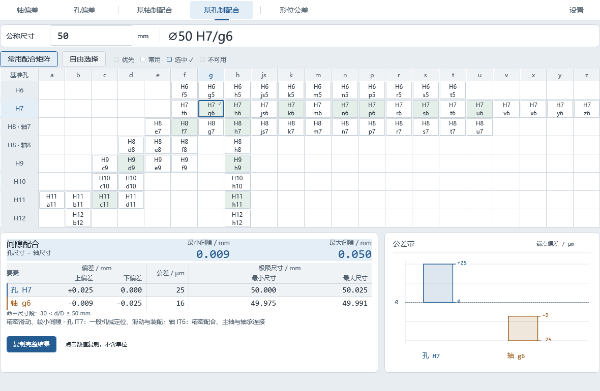

# 公差查询工具

用于查询孔轴尺寸公差、配合和形位公差的 Windows x64 离线工具，下载后可直接运行。

**v0.4.0 测试版**提供独立 EXE 和便携 ZIP。[前往下载](https://github.com/Max-lu-4416/geometric-tolerance-tool/releases/tag/v0.4.0)

## 主要功能

- 查询孔轴上、下偏差、公差宽度及极限尺寸。
- 查询基孔制与基轴制配合，查看间隙或过盈范围及公差带图。
- 查询形位公差的数字等级或 H/K/L 未注公差。

## 快速使用

1. 在查询页按提示输入尺寸或主参数，单位为 mm。
2. 选择公差带、配合组合或形位公差等级，查看结果。
3. 点击结果数值复制单项，或点击「复制完整结果」。

输入使用英文小数点。具体收录范围、H/K/L 条件和设置说明见使用指南。

## 更多资料

- [使用与构建指南](docs/usage.md)
- [发布历史](https://github.com/Max-lu-4416/geometric-tolerance-tool/releases)
- [验证记录](VALIDATION.md)
- [MIT 许可证](LICENSE) · [第三方许可与署名](NOTICE.md)
