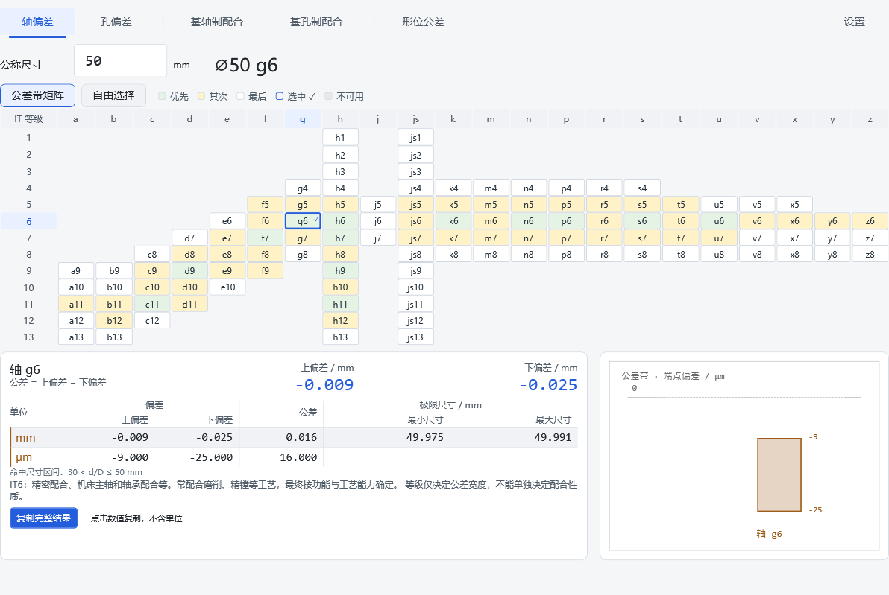
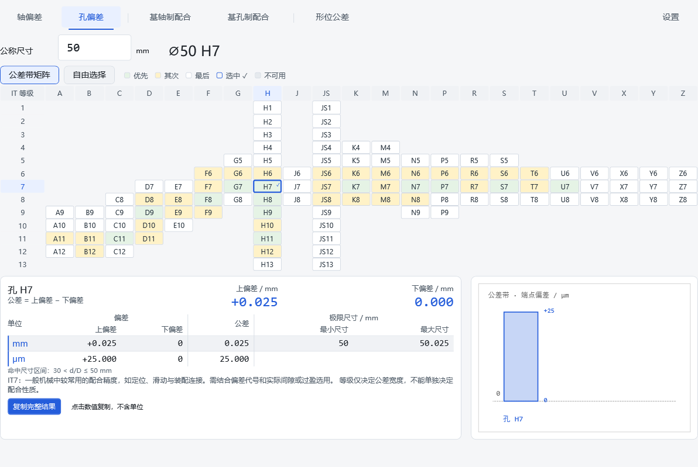

# 公差查询工具 v1.3.7

Windows x64 离线桌面程序，免安装运行。

从 [v1.3.7 发布页](https://github.com/Max-lu-4416/geometric-tolerance-tool/releases/tag/v1.3.7) 下载 EXE 或便携 ZIP。运行版无需安装 .NET；历史 v1.0、v1.3.1 仍保留。





[配合矩阵预览](docs/query-preview.png) · [UI 前后对照](docs/ui-comparison.html)

## v1.3.7 文字精简

六页移除与导航重复的页标题；形位三栏上移，四个尺寸页将公称尺寸输入靠左。正常自动保存不再提示，操作介绍移至矩阵/自由选择按钮以及主题/小数显示选项的悬停说明。聚焦对应控件按 F1 查看，Esc 关闭；切换页面或离开控件也会关闭说明。

常显复制说明缩短为“点击数值复制，不含单位”。单位、主参数含义和范围、颜色图例、等级用途、尺寸区间、关于署名和重要警告继续直接显示。保存失败和设置损坏恢复提示保留，复制反馈位于底部；后台保存成功不会覆盖复制反馈。计算、设置格式及完整结果复制文本不变。

[文字精简前后对照](docs/text-cleanup.md)

## v1.3.6 矩阵定位与交互

参考 UI UX Pro Max 的 WPF 与可访问性指南，保留现有页面结构。四个尺寸页的矩阵高亮当前行、列标题，当前选中格使用独立的加粗蓝框与勾号；无效尺寸保留所选位置。键盘焦点采用虚线内框，与查询选中状态分开，按钮按下提供即时反馈。输入数字使用等宽字体，统一明暗主题边框及焦点。

数字仍按显示内容点击复制，无单位、无额外步骤；查询数据、尺寸范围、矩阵等级、H/K/L 与设置格式不变。关于页新增 UI UX Pro Max 来源及 MIT 说明。

[本轮改进与验证](docs/ui-ux-pro-max-polish.md)

## v1.3.5 形位查询栏与导航

顶部按孔轴偏差、配合、形位分组，设置靠右；六个页面的顺序和功能不变。形位中栏将标注公差数字等级与 H/K/L 分组，主参数输入旁显示 mm。公差结果为重点，mm 与 μm 同行显示并可分别点击复制，完整结果按钮紧随结果与规则说明。

[形位中栏预览](docs/geometry-query-after.png) · [顶部导航预览](docs/navigation-after.png) · [unslop 精修记录](docs/geometry-navigation-polish.md)

## v1.3.4 四页统一与关于

轴偏差、孔偏差、基轴制及基孔制配合共用结果区。单项页上方突出上、下偏差（mm），表格保留 mm/μm 双行；配合页继续突出间隙或过盈。极限尺寸始终为 mm，仅在单项表格的 mm 行显示。点击数值复制与显示一致，仍保留尺寸标题复制和完整结果按钮。

设置底部新增“关于”：显示程序集实际版本、作者 Max-lu-4416、仓库、自有代码 MIT 说明、.NET/WPF 第三方许可，以及 unslop / Damir Sokolovsky / CC BY 4.0 署名。仓库链接仅由用户点击后打开，不自动联网。

[轴偏差结果区](docs/unified-shaft-result.png) · [孔偏差结果区](docs/unified-hole-result.png) · [关于预览](docs/about-preview.png)

## v1.3.3 点击复制

五个查询页点击结果数字即可复制，按显示内容保留正负号和可见补零，不附带单位；单位以表头或数字旁标注为准。四个尺寸页点击顶部尺寸标题复制完整标注。仅保留“复制完整结果”按钮，鼠标悬停或键盘聚焦会出现下划线，可用 Enter、空格复制。输入框、等级和图解刻度不是复制入口。

例如点击 +0.039 mm 复制 +0.039，点击 39 μm 复制 39；不按历史的默认复制单位换算。设置中已移除该选项，旧 JSON 文件仍能读取。每次成功复制会提示字段、数值和单位，无效查询时所有数字和标题不可复制。

[点击复制预览](docs/click-copy-preview.png)

## v1.3.2 本地预览

保留孔轴对照表，在上方突出最小、最大间隙或过盈；过渡配合分别显示最大间隙和最大过盈。表头按偏差、公差宽度、极限尺寸分组，孔蓝、轴橙与图解一致。用途与等级说明置于次级区域，主要复制操作前置。查询数据、设置格式和复制精度保持一致。

[结果区预览](docs/fit-result-after.png) · [本次调整记录](docs/fit-results-ui.md)

## v1.3.1 更新

包含六页统一 UI、孔轴公差带矩阵和配合矩阵；清理无用样式、常量与分支，统一精确小数解析和孔轴等级说明。复制文本直接由查询结果生成；剪贴板占用时最多尝试六次，查询改变或切换页面会取消旧复制任务。数据和查询规则保持不变。

## 使用

顶部按顺序切换：轴偏差、孔偏差、基轴制配合、基孔制配合、形位公差、设置。

轴／孔偏差：输入公称尺寸，直接点击 g6、H7 等公差带格子，同时选定代号和等级。浅色矩阵按优先（淡绿）、其次（淡黄）、最后（白色）标识，深色使用对应深绿、深黄和中性深底；蓝框加勾号表示当前选择，尺寸无效项灰显。矩阵覆盖孔 105 格、轴 116 格；大于 500 mm 时按孔 31 格、轴 41 格的大尺寸选用范围更新。三级顺序仅用于 500 mm 以内，全部收录代号及 IT1～IT18 仍可通过自由选择查询。结果显示上、下偏差、公差宽度和极限尺寸。尺寸用 mm，偏差同时显示 mm 和 μm。

配合：点击全宽矩阵中的完整孔轴组合，或切换“自由选择”分别点选公差带与等级。淡绿为经过核对的优先配合，白色为常用配合，蓝框与勾号为当前选择，灰色为当前尺寸不可选。基孔制 H8 按轴等级分为独立子行。基孔制固定 H，基轴制固定 h。常用组合只用于 500 mm 以内，灰色项目表示当前尺寸没有有效收录值。性质与范围按实际孔轴偏差计算，可能随尺寸而变化。

图中蓝色表示孔，橙色表示轴，两者使用同一真实比例坐标，虚线为零线，端点数字为 μm。可复制单项偏差、尺寸标注或完整结果；偏差数值复制不带单位，极限尺寸始终按 mm 复制。

初始示例为 50 mm：g6、H7、G7/h6、H7/g6。H7/g6 的间隙为 0.009～0.050 mm。点击 IT 等级显示用途说明，选型仍需结合功能、工艺和检测能力。

形位公差：

1. 点击左侧的公差符号。
2. 点击中间的数字等级或 H/K/L。右下角显示该等级的适用场景、典型零件和选用提示。
3. 输入参数，查询结果即时更新；右上角图例始终可见。
4. 点击公差值的 mm 或 μm 数字复制单项，点击“复制完整结果”获取全部结果。数值复制不含单位。

查询页使用固定矩阵或三栏布局，没有页面滚动条。窗口缩小时自动等比例缩放；启动时适应可用桌面空间。

## 尺寸公差收录范围

内嵌孔轴共 56 个基本偏差代号、7,283 个有效单元格，覆盖收录尺寸至 3150 mm。只提供实际收录的代号、等级及尺寸组合，不使用公式补齐空白，不插值、不外推。不同代号和等级的适用范围不同，未收录项禁用。

A/B/a/b 在小于 1 mm 时不采用；IT14～IT18 在小于或等于 1 mm 时不采用。大于 500 mm 的 IT1～IT5 收录项显示“试用值”。修改尺寸导致原组合无效时保留选择，清空结果、公差带图并禁用复制。

63 个收录单元格的实际偏差宽度与同级标准宽度不同（包括对称偏差取整项）。程序保留实际偏差并提示，未自动改写原值。相应配合也会传递提示。

结果表按列右对齐并只补零对齐小数位，不截断数值。点击复制与显示文字完全一致，包含正负号及用于对齐的补零。

## 设置

- 启动页：默认恢复上次查询页；首次进入形位公差，也可指定查询页。
- 记住输入：默认开启，每个查询页分别保存；关闭后清除磁盘上的输入记录。
- 窗口置顶：默认关闭，仅作用于本工具。
- 小数：自动或至少 3、4、6 位，只补零，不截断有效精度。
- 主题：浅色、深色、跟随系统；图例与公差带保持白底。
- 字号：标准或大号；恢复默认会重置设置和各页输入。

设置保存在 `%LOCALAPPDATA%\ToleranceTool\settings.json`，采用版本化 JSON 和原子替换。文件损坏或版本无法识别时使用默认设置。程序免安装，但设置随当前 Windows 用户保存。

## 数字等级

| 类型 | 等级 | 主参数范围 / mm |
| --- | --- | --- |
| 直线度、平面度 | 1～12 | 大于 0，至 10000 |
| 圆度、圆柱度 | 0～12 | 大于 0，至 500 |
| 同轴度、对称度、圆跳动、全跳动 | 1～12 | 大于 0，至 10000 |
| 平行度、垂直度、倾斜度 | 1～12 | 大于 0，至 10000 |

等级说明随公差类型变化，数字越小要求越严格。典型场景供初选，应先满足功能要求，再考虑加工与检测能力。

## H/K/L 未注公差

H 要求较严格，K 居中，L 较宽松；三者用于未单独标注的几何公差。H/K/L 与数字等级是两种查询模式，没有直接换算关系。

| 类型 | 需要输入 | 处理规则 |
| --- | --- | --- |
| 直线度、平面度 | 基本长度，最大 3000 mm | 按长度分段选值 |
| 垂直度 | 直角两边中较短边长度，最大 3000 mm | 较长边作为基准 |
| 对称度 | 被测要素基本长度，最大 3000 mm | 至少一个要素为中心平面，或两要素轴线互相垂直；较长要素作为基准 |
| 圆跳动 | 无需主参数 | H=0.1 mm，K=0.2 mm，L=0.5 mm |
| 圆度 | 直径尺寸公差总宽 | 与径向圆跳动限值取较小值 |
| 平行度 | 基本长度及尺寸公差总宽 | 与相应直线度或平面度限值取较大值 |
| 圆柱度、同轴度、倾斜度、全跳动 | 无直接数值 | 显示具体规则说明，不自动生成通用数值 |

尺寸公差总宽是上极限尺寸减下极限尺寸。例如尺寸标为 ±0.1 mm，应输入 0.2 mm。尺寸公差输入框仅在需要时显示。

采用未注等级时，技术要求可标注 `GB/T 1184-H`、`GB/T 1184-K` 或 `GB/T 1184-L`。已有单独标注的要素按单独标注执行。

## 输入与边界

统一使用 mm，1 mm=1000 μm。使用英文小数点，不加单位、千位分隔符或科学计数法。

尺寸分段按“大于下限、至上限”匹配，不插值或外推。空值、负数、零、超范围及不能精确表示的小数会清空结果并禁用复制。

本版提供查询、选用说明和复制；位置度保留为灰色说明项，不直接写入 CAD。

## 构建

使用 .NET 10 SDK；运行发布版无需安装 .NET。无第三方 NuGet 包。

```powershell
dotnet run --project Tests/Tolerance.Tests.csproj -c Release
./build.ps1
New-Item -ItemType Directory artifacts/ui-verification -Force
& './artifacts/geometric-tolerance-tool-v1.3.7/几何公差查询工具.exe' --verify-all './artifacts/ui-verification'
```

程序内验证检查控件事件、绑定、H/K/L 条件、剪贴板、图例加载、设置恢复及固定布局。通过 WPF 直接渲染预览，不使用桌面自动化或更改显示设置。完整形位回归另使用 `--verify-ui`。

`build.ps1` 默认输出到仓库内的 `artifacts/geometric-tolerance-tool-v1.3.7`，可通过 `-OutputDir` 指定目录、`-Dotnet` 指定 SDK 可执行文件。编译与测试只依赖已提交的内嵌数据和样本，不依赖原始 PDF。

## 许可

自有代码采用 [MIT](LICENSE)，第三方许可、数据与图示权利范围见 [NOTICE.md](NOTICE.md)。

界面设计流程参考 [unslop](https://github.com/heydamir/unslop)，作者 Damir Sokolovsky（@heydamir），CC BY 4.0；保留署名和来源。
