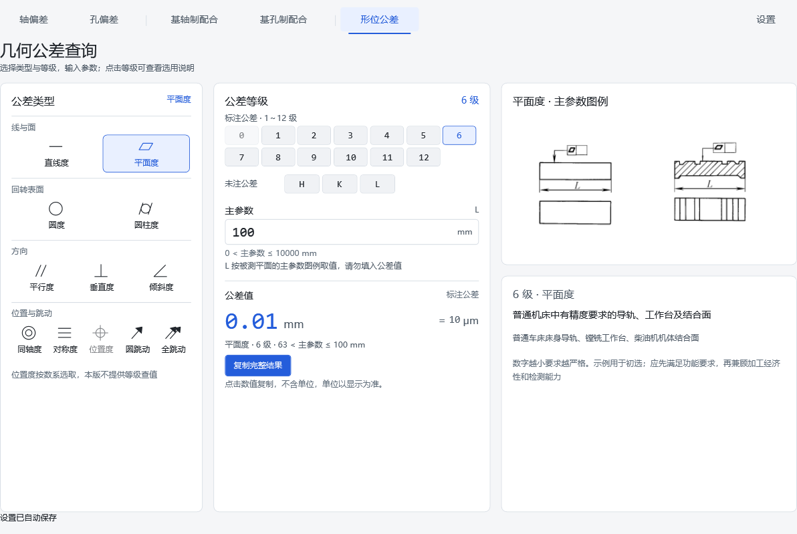
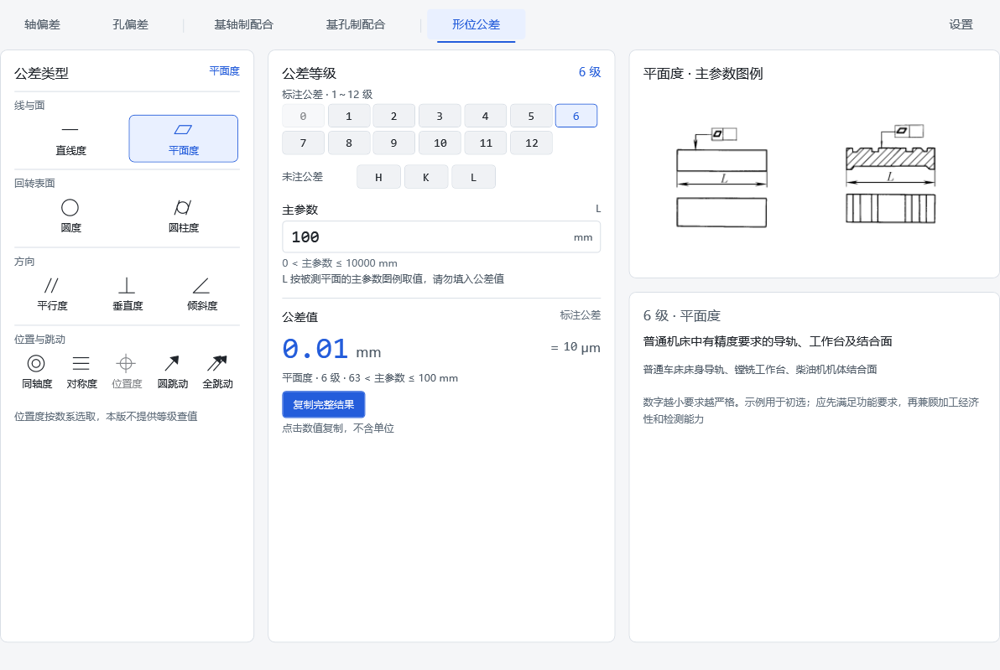
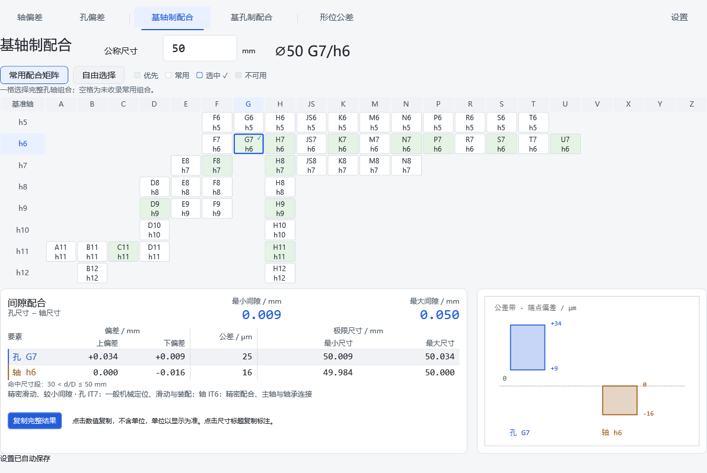
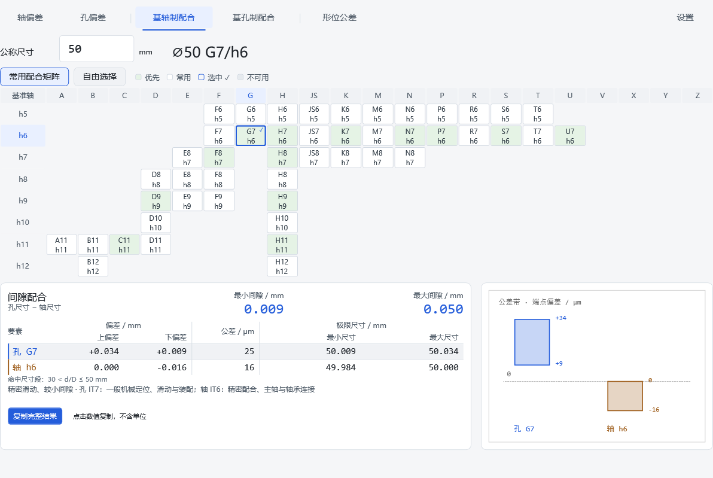
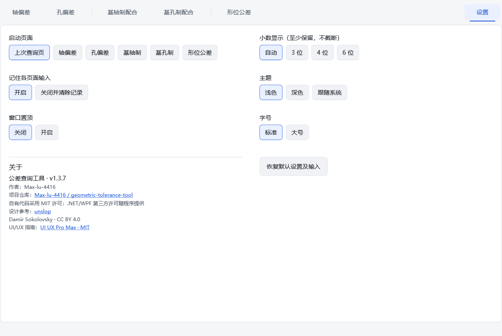

# v1.3.7 文字精简

保留顶部导航、可复制的尺寸标注、矩阵、结果、图解和关于。删除页面内部重复标题和正常保存状态，让输入和结果更靠前。

## 常显内容

- 公称尺寸、主参数含义及范围、mm/μm 单位、颜色图例、等级用途、命中区间。
- 点击数值复制，不含单位。尺寸标题仍可点击复制标注，唯一复制按钮仍为“复制完整结果”。
- 输入错误、组合不可用、矩阵大尺寸限制、试用值和宽度差异警告。
- 保存失败、设置损坏恢复和操作反馈；保存成功保持安静，不覆盖已有复制反馈。

## 按需说明

矩阵操作、空白格、H8 子行和自由选择介绍移到模式按钮的提示。主题的白底图解说明及小数选项的单位规则也移入提示。鼠标悬停查看；键盘聚焦对应按钮后按 F1，Esc 关闭。页面切换、焦点离开或控件卸载时关闭旧提示。

核心查询接口、内嵌数据、设置 JSON、88 份完整查询结果文本、剪贴板重试和取消规则保持兼容。矩阵区高 312、结果区高 276；正常情况下收起说明行，特殊限制仍直接显示。无页面滚动条，不调用 computer use。

## 对照

设计核对沿用 UI UX Pro Max 的 WPF/可访问性建议及 unslop 的工程查询台方向；许可和署名见 NOTICE.md。最终检查统计及日志见随附验证记录。
