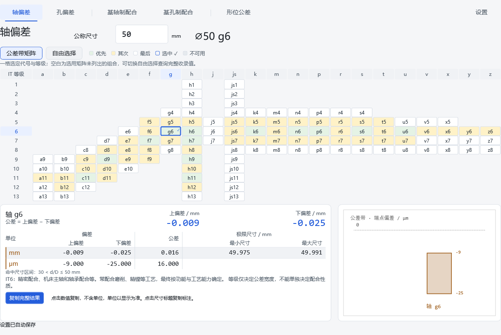
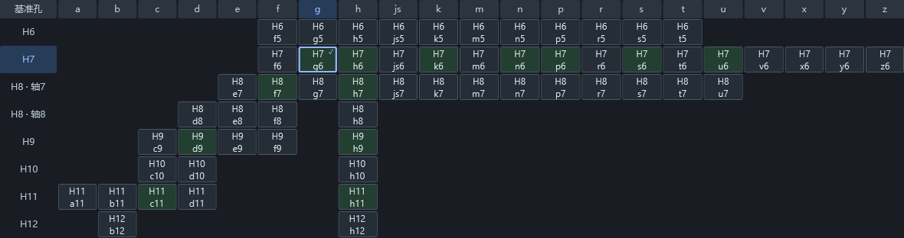

# v1.3.6 UI UX Pro Max 精修

继续使用工程查询台的紧凑蓝灰风格，保留六页结构、矩阵密度与点击数值复制。新增样式只处理展示和交互反馈，不改动计算、数据、范围或设置格式。

## 指南与取舍

- 已安装 UI UX Pro Max，版本固定到来源提交 `4f2dbb67e64969a9a30ab00742f2d55d66ddec2b`。
- 执行本地设计系统检索、产品检索、WPF 栈与可见焦点 UX 检索。设计系统返回的营销首页结构不适用于工程工具，进一步产品检索无匹配；不采纳其首页、CTA 和网络字体建议。沿用此前确认的设计方向，采用已匹配的 WPF 键盘导航与 UX 焦点规则。
- 桌面矩阵保持紧凑鼠标操作，不机械套用手机 44pt 触控尺寸，不引入 GSAP 或网络资源。

## 本轮修改

1. 矩阵增加行、列标题高亮，帮助追踪代号和等级。H8 子行继续独立定位。
2. 选中格保留类别底色，以加粗蓝框与勾号显示选择；键盘焦点采用独立虚线内框，聚焦不改变查询。
3. 统一输入框数字字体、圆角、主题边框及焦点显示；按钮增加按下反馈，禁用控件不显示手形。
4. 增补公称尺寸的可访问名称和单位、矩阵分类/选中/禁用状态、设置组选中状态。数字的原有 Enter/空格复制保留。
5. 关于页保留 unslop 署名，增加 UI UX Pro Max 的来源和 MIT 说明。

## 验证

程序内 WPF 回归检查行列定位、选中与焦点分离、尺寸无效后保留、输入字符显示边界、主题对比度及六页布局。继续覆盖两种字号、最小窗口、100%/150% 直接渲染、剪贴板与查询回归。没有使用 computer use、UI Automation 或桌面截图。

首轮渲染发现输入模板重复内边距导致字符裁切，已修正，并增加字符矩形位于控件内的断言。最终统计和发布目录运行结果见随附验证记录。

参考：[UI UX Pro Max](https://github.com/nextlevelbuilder/ui-ux-pro-max-skill)，MIT，Next Level Builder；[unslop](https://github.com/heydamir/unslop)，Damir Sokolovsky，CC BY 4.0。
